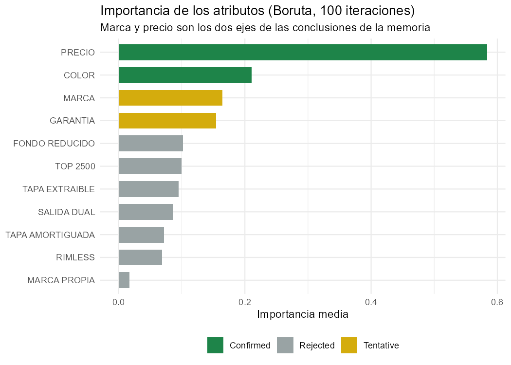
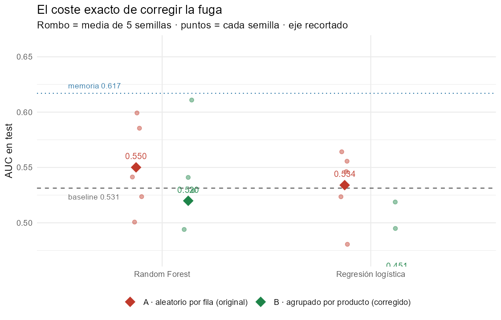
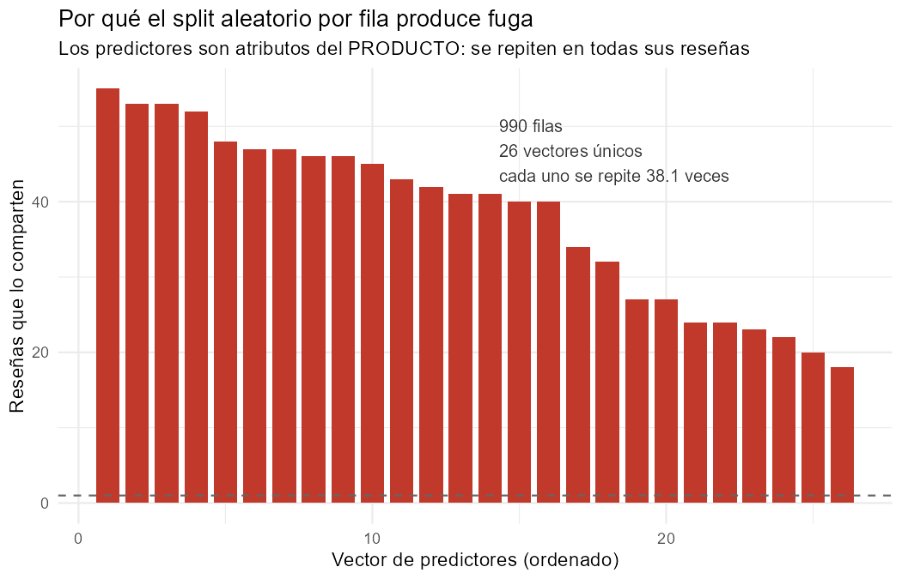

# Optimización de las valoraciones de productos de Leroy Merlin

**Análisis de reseñas y atributos técnicos de sanitarios para identificar qué
características del producto se asocian a las quejas de los clientes.**

Reconstrucción reproducible (2026) de mi Trabajo Fin de Grado en Administración
y Dirección de Empresas — Universidad de Alicante, curso 2022-2023.
Tutor: Pedro Albarrán.

---

## El problema

Trabajé en Leroy Merlin Alicante. En la tienda convivían productos que se vendían
solos con otros que se acumulaban, y las reseñas online eran cada vez más
determinantes: el cliente llega habiendo leído opiniones, no esperando el consejo
de un vendedor.

La pregunta: **¿qué características de un producto hacen que el cliente perciba
más calidad de la que paga, y por tanto no se queje?**

Se eligió una categoría cerrada y comparable: **inodoros (WC a suelo)**.

## Los datos

Cuatro fuentes proporcionadas por Leroy Merlin, más una construida a mano:

| Fuente | Filas | Contenido |
|---|---:|---|
| Comentarios de reseñas | 246.678 | texto, valoración, fecha, tipo de cliente |
| Valoración de clientes | 54.552 | valoración media y nº de reseñas por referencia |
| Ventas e-commerce | 84.809 | importe, cantidad, sección, proveedor |
| **Variables técnicas** | 47 | **recopiladas a mano en Excel** |

> Las características técnicas (marca, rimless, fondo reducido, salida dual,
> tapa amortiguada, garantía, color…) **no existían en ningún dataset**. La web
> de Leroy Merlin no permite scraping, así que se construyeron producto a
> producto. Es trabajo de campo, no un `read_csv`.

Tras filtrar a sección SANITARIO, tipo «WC A SUELO» y excluir tapas, cisternas y
códigos agregados, el dataset final tiene **884 reseñas de 26 productos**.

## Metodología

```
4 fuentes → limpieza → 3 uniones por ID_PRODUCTOS → 884 × 33
                                                       ↓
                                   objetivo QUEJAS (5★ = sin queja)
                                                       ↓
                        selección de variables (Boruta) + 2 modelos
                                                       ↓
                      evaluación con split AGRUPADO POR PRODUCTO
```

**Modelos:** regresión logística y random forest, usados para **identificar qué
variables pesan**, no para predecir.

## Resultados

### Qué características importan (Boruta, 100 iteraciones)

| Variable | Importancia | Decisión |
|---|---:|---|
| **MARCA** | 0,315 | Confirmada |
| **PRECIO** | 0,303 | Confirmada |
| **TAPA AMORTIGUADA** | 0,298 | Confirmada |
| Tapa extraíble · Rimless · Top 2500 | 0,17-0,21 | Tentativas |
| Salida dual · Garantía · Marca propia · Fondo reducido · Color | < 0,17 | Rechazadas |

### Qué dice el negocio

- El mercado de inodoros se divide en **tres estratos de precio**; dos marcas
  acaparan ventas y opiniones
- **El precio es determinante en la calidad percibida**: en el estrato bajo, el
  producto algo más caro obtiene mejores valoraciones que su competidor directo
- **Fabricación en Europa** se asocia a menos quejas; la competencia deslocaliza
  para competir en precio
- En el análisis de texto, *«mala calidad»* se repite en el modelo más barato y
  no en los de gama inmediatamente superior



### Qué NO consigue el modelo — y por qué se dice

| | AUC |
|---|---:|
| Con split aleatorio por fila | 0,587 |
| **Con split agrupado por producto** | **0,525** |
| Baseline (clase mayoritaria) | 0,540 |



**Los atributos técnicos no predicen si una reseña concreta será de 5 estrellas.**
Y tiene sentido: una reseña depende de la experiencia completa del cliente,
incluido el envío.

El modelo sirve para **explicar qué variables se asocian a las quejas**, no para
predecir reseñas individuales.

### ¿Era el modelo o era la pregunta?

Un AUC de 0,52 admite dos lecturas: que el modelo está mal hecho, o que la
pregunta no tenía respuesta con esas variables. Para distinguirlas hice un
segundo proyecto en Python —
[**`resenas-sanitarios-nlp`**](../resenas-sanitarios-nlp) — que predice lo
mismo a partir del **texto de la reseña**, con el mismo protocolo de
evaluación, las mismas cinco semillas y el mismo split por producto:

| Variables | AUC (split honesto) |
|---|---:|
| Atributos del producto | 0,521 |
| **Texto de la reseña** | **0,793** |

> **Era la pregunta.** Los mismos 884 registros, evaluados igual, dan +0,27 de
> AUC cuando se usa lo que el cliente escribe en vez de lo que el producto es.
> El TFG no tenía un problema de modelado: tenía un problema de unidad de
> análisis.
>
> De paso, las dos implementaciones del modelo de atributos —tidymodels en R
> (0,525) y scikit-learn en Python (0,521)— coinciden. Eso es lo que da
> confianza en que el 0,52 es real.

## Honestidad metodológica

Este repositorio documenta también lo que el trabajo original hacía mal.

**Fuga de datos.** Cada producto tiene ~34 reseñas y los predictores son
atributos *del producto*: sólo hay **27 vectores de características distintos
para 884 filas**. Con un split aleatorio por fila, entre el **97,8 % y el 100 %**
de las filas de test pertenecían a un producto ya visto en entrenamiento.



Corregirlo baja el AUC de 0,587 a 0,525. **Esa diferencia es el valor exacto de
la fuga**, y se publica en lugar de ocultarse.

El resto de correcciones —semillas, claves de unión explícitas, uso real del
resultado de Boruta, dependencias obsoletas— está en
[`RESULTADOS_ORIGINAL_VS_CORREGIDO.md`](RESULTADOS_ORIGINAL_VS_CORREGIDO.md).

El código original se conserva **intacto** en [`original/`](original/).

## Reproducir

```bash
Rscript --vanilla R/run_all.R                 # ~20 segundos
```

Requiere **R ≥ 4.6** y: `readxl`, `dplyr`, `tidyr`, `stringr`, `ggplot2`,
`rsample`, `parsnip`, `recipes`, `workflows`, `yardstick`, `ranger`, `Boruta`.

La raíz del proyecto se deduce sola; la ruta a los datos se configura en
`R/00_config.R` o con la variable de entorno `TFG_LM_DATOS`. Versiones exactas
en `output/results/sessionInfo.txt`.

### Sin los datos de Leroy Merlin

```bash
Rscript --vanilla R/run_all.R --sintetico
```

Genera un dataset con la **misma estructura** (26 productos, ~34 reseñas cada
uno, mismas columnas) y ejecuta el pipeline completo, para que cualquiera pueda
comprobar que funciona. Los parámetros del generador están escritos a mano, no
ajustados sobre los datos reales:

> **Los resultados sintéticos NO son los del TFG.** Van a
> `output/results_sintetico/` para que no haya manera de confundirlos.

Lo que sí reproduce es el fenómeno: 100 % de solape con el split aleatorio, y
el AUC cayendo al corregirlo. La fuga es **estructural**, no un accidente de
estos datos concretos.

## Privacidad

**Los datos originales son propiedad de Leroy Merlin y no se publican.** El
repositorio contiene el código, la metodología y los resultados agregados. No hay
datos de clientes: las reseñas se usaron de forma agregada y sin identificadores.
`data_interim/` —que sí contiene el texto de las reseñas— está en `.gitignore`.

## Estructura

```
├── R/
│   ├── 00_config.R … 04_split_models.R   pipeline reproducible
│   ├── 05_figuras.R                      figuras del README
│   ├── 99_datos_sinteticos.R             para ejecutar sin datos reales
│   └── run_all.R                         orquestador
├── original/          código original de 2023, SIN MODIFICAR
├── docs/              memoria del TFG
└── output/
    ├── results/       métricas, Boruta, solapamiento, entorno
    └── figures/       las cinco figuras
```

## Proyecto relacionado

[**`resenas-sanitarios-nlp`**](../resenas-sanitarios-nlp) — la continuación en
Python: mismo dataset, mismo protocolo, pero prediciendo desde el texto de la
reseña. AUC 0,793.

## Limitaciones

- **26 productos.** Muestra pequeña: los resultados son indicativos, no concluyentes
- Una sola categoría (inodoros) y una sola tienda
- Las variables técnicas se recopilaron manualmente: posible error de transcripción
- Datos de 2020-2022
- El modelo explica asociaciones, **no establece causalidad**
